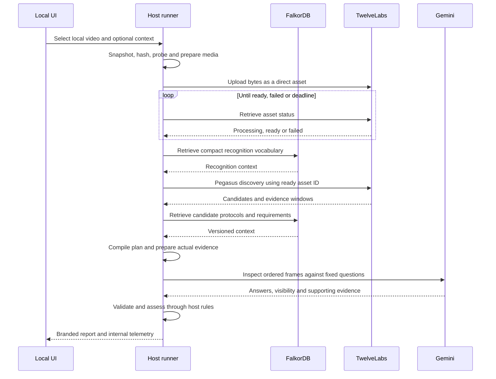

# Local application build specification

## Scope and architecture

Deliver a single-user Windows-friendly local research app. The host reads approved video files, prepares media, directly uploads to providers, retrieves FalkorDB context, runs fixed or Code Mode orchestration and writes reports/telemetry. Bind UI/API to loopback. Store metadata in SQLite and larger artifacts in per-run folders. Do not build cloud upload/auth/billing/distributed queues.

Retain provider, media, ontology, orchestration, assessment, reporting and telemetry as modules with stable interfaces so the worker can later reuse them. Use safe subprocess argument arrays, path canonicalisation and job-owned media IDs. Avoid shell interpolation. Stream large files rather than base64-encoding the entire video.

## Local sequence

Code Mode may generate/adapt the execution program before and between these tool calls. Every planner call must appear in the trace. The model never obtains API keys or raw filesystem access.

## Project outputs The coding agent must implement

- npm scripts: doctor, provider:smoke, ontology:import, analyse, ui, batch, test and build.
- Config schema with unknown-key rejection, env resolution, positive bounded limits and a redacted resolved-config hash. Fail on missing keys/models for the requested mode; doctor should list all missing inputs together.
- Doctor: executable versions, writable outputs, readable ontology, graph connectivity/import hash, server port and config checks. No paid inference by default.
- Single-file and batch CLI; UI supports a file picker or registered input-root files. Do not enumerate the whole disk. No-context is the default.
- Run states: queued, preparing, uploading, waiting_for_asset, discovering, comparing, inspecting, assessing, reporting; outcomes completed, completed_partial, needs_context, rejected, failed, cancelled.
- Live progress events with real stage durations and elapsed time; no fabricated percentage or claim that a detector ran.
- Cancel and resume: checkpoint media manifests, ready asset IDs, completed requests and evidence. Cache hit records carry zero new provider usage but reference original artifacts and provenance.
- Store each run in an immutable unique directory. Re-running the same clip makes a new run record even if outputs are reused. Track original/reused span relationships.
- Cleanup command for local cache and provider assets using verified ownership and supported delete APIs; do not promise deletion succeeded without checking.

## Local source integrity

Snapshot or hash-verify the selected input before and after reading. Record original file hash, prepared-media hash, source timestamps and all transforms. Preserve source audio. For discovery tests, give providers neutral asset names; do not leak sport labels through filenames, directory names or evaluation answers.

Normalisation may resize to provider-valid dimensions and create H.264 playback for browser compatibility. Do not use enhancement/interpolation to fabricate evidence. Seek maps must account for non-zero start times, rotations, cuts and variable frame rate; frame_index / average_fps is insufficient for variable-rate recordings.

## Modes

- ontology_fixed: reviewed program and the same managed provider/ontology tools; no generated orchestration.
- ontology_code: bounded generated/adapted code, with optional reviewed-program reuse. Capture generated code and executor version internally.

These modes isolate the value of adaptive orchestration. A reconstructed baseline from unknown production prompts must not be labelled an exact reproduction. Existing exported reports can be imported as labelled comparison artifacts, never treated as ground truth.

## Live run gate

All offline/mock tests must pass first. The user invokes provider:smoke to verify billable operations with their own keys. Missing credentials must not prevent the rest of the app being implemented or silently switch providers.
